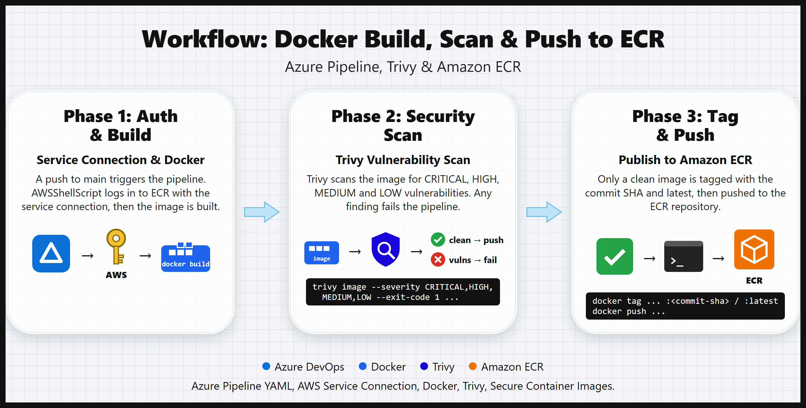

# Azure Pipelines
This folder contains a pipeline that builds a Docker image and pushes it to Amazon ECR for vulnerability scanning. If vulnerabilities are detected, the pipeline fails and halts the deployment process. If no vulnerabilities are found, it proceeds with the deployment automatically, ensuring secure container images.

### Structure
- azure-pipelines.yml
- workflow.png
- README.md

### Comments and recomendations
- Pipelines for Azure Devops
- Install the [AWS Toolkit for Azure DevOps](https://marketplace.visualstudio.com/items?itemName=AmazonWebServices.aws-vsts-tools) extension and create an AWS service connection named `aws-dev-connection` (or update `awsCredentials` in azure-pipelines.yml)
- Set `AWS_REGION`, `AWS_ACCOUNTID` and `DOCKER_REPOSITORYNAME` in the `variables` section of azure-pipelines.yml
- It is required to have an aws account.

### 🔄 Workflow

  

#### Repository version
v 0.1.0
